# 🦄 유니코 팜 (UNICO Farm) — 농업 메타버스

한국농업기술진흥원 마스코트 **유니코(UNICO)** 와 함께하는 캐주얼 3D 농장 메타버스 게임입니다.
브라우저에서 바로 실행되며, 같은 서버에 접속한 사람들이 한 농장에서 서로를 보고 채팅할 수 있습니다.

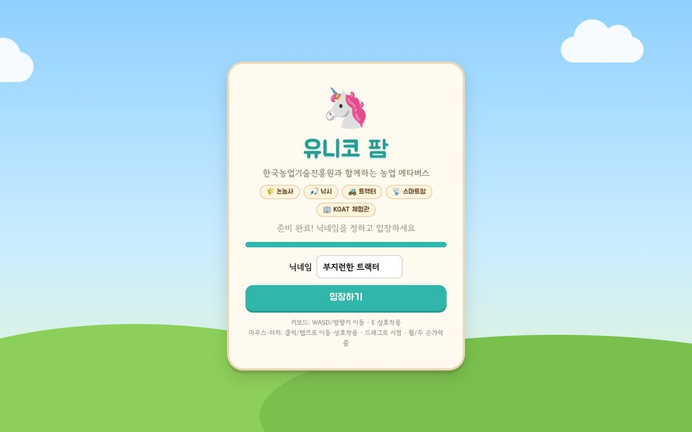

| 농장 마을 | 논농사 | 연못 낚시 |
|---|---|---|
| 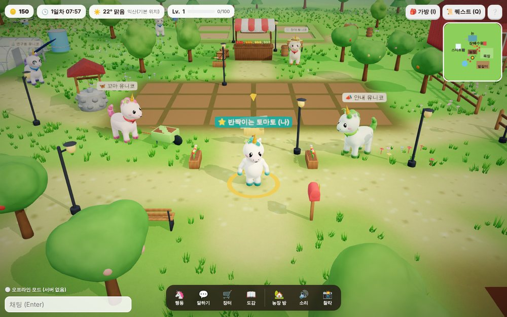 | 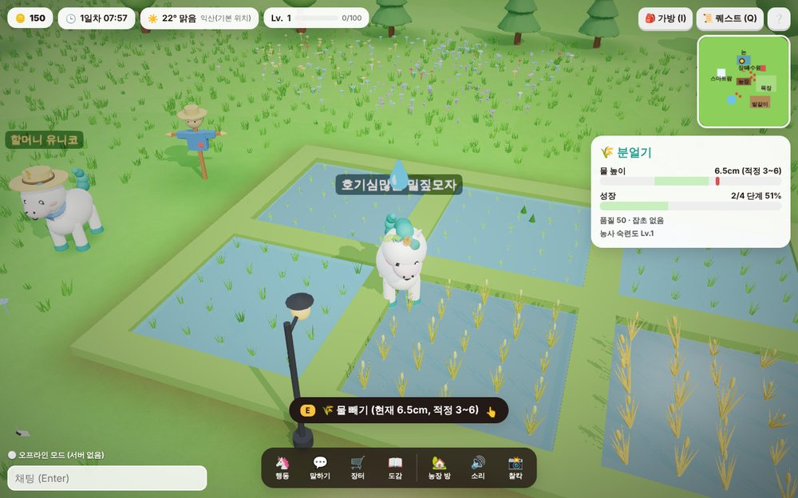 | 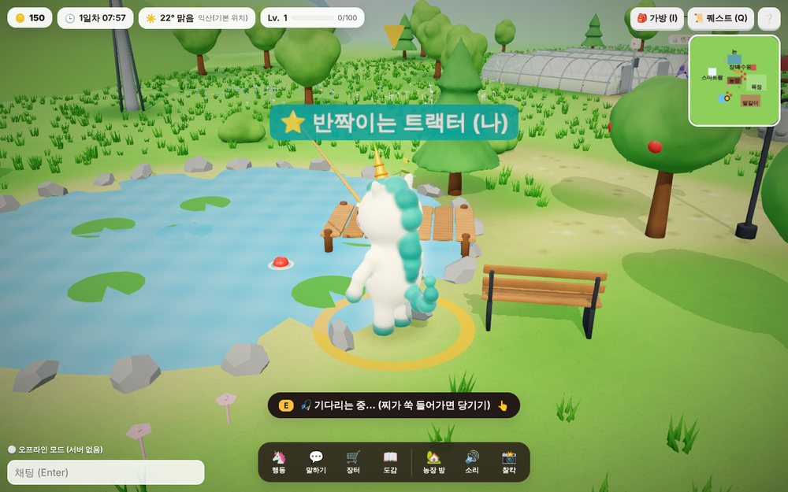 |
| **과수원** | **주민 우정·선물** | **도감** |
| 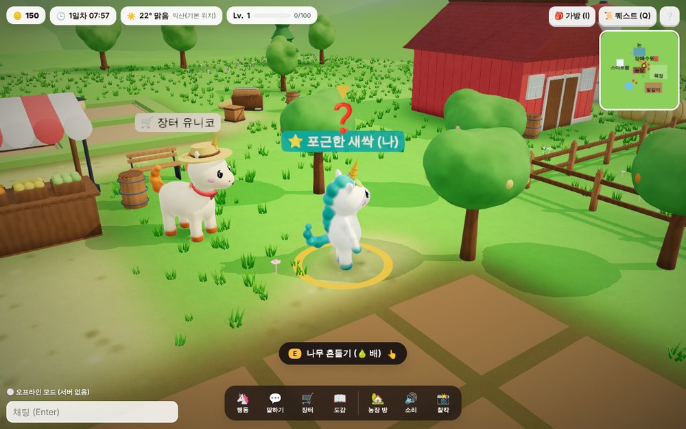 | 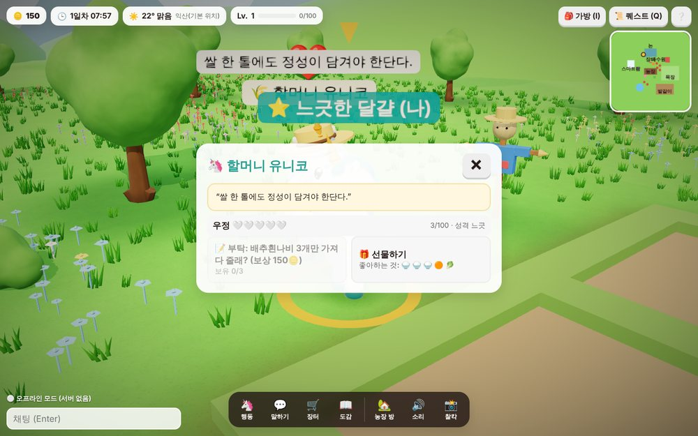 | 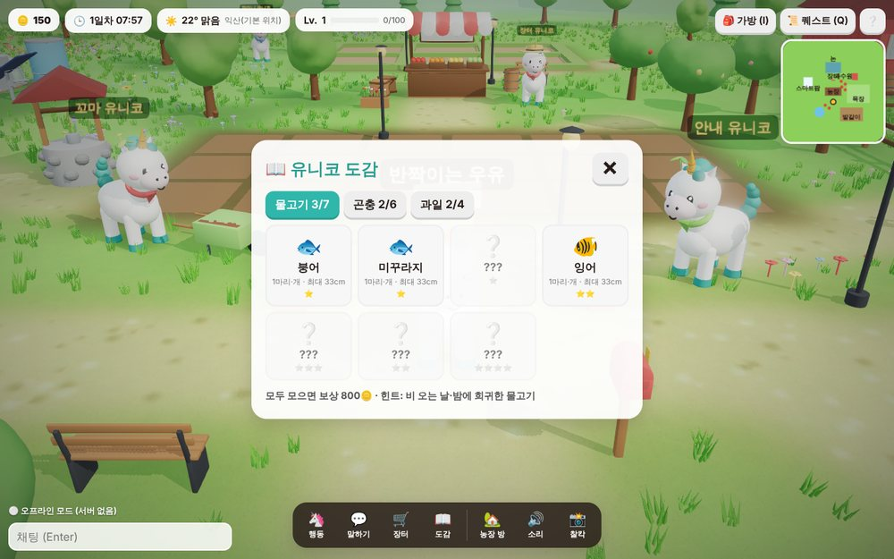 |
| **목장** | **트랙터 밭갈이** | **실시간 날씨 (비)** |
| 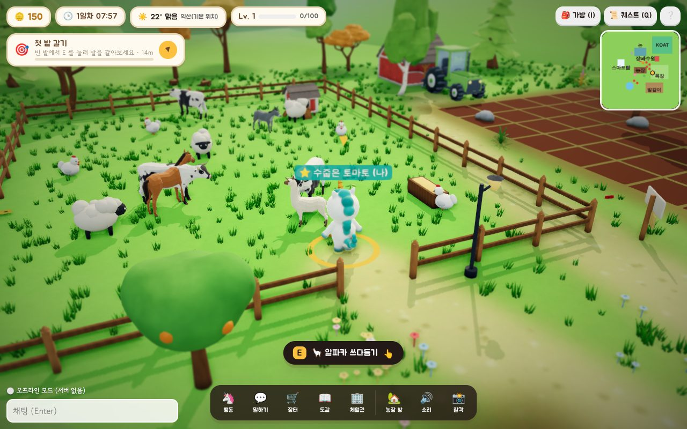 | 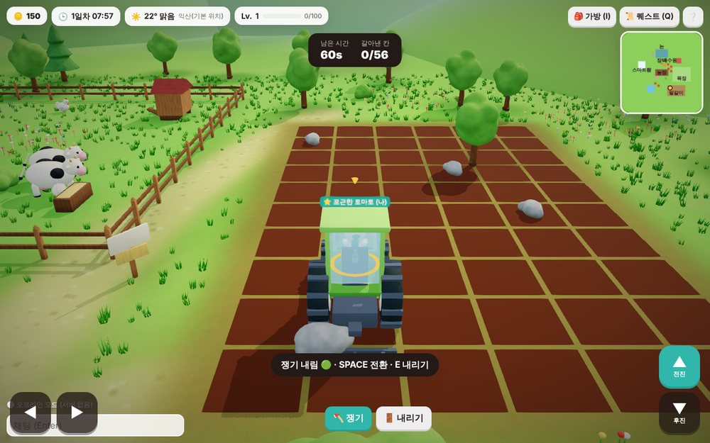 | 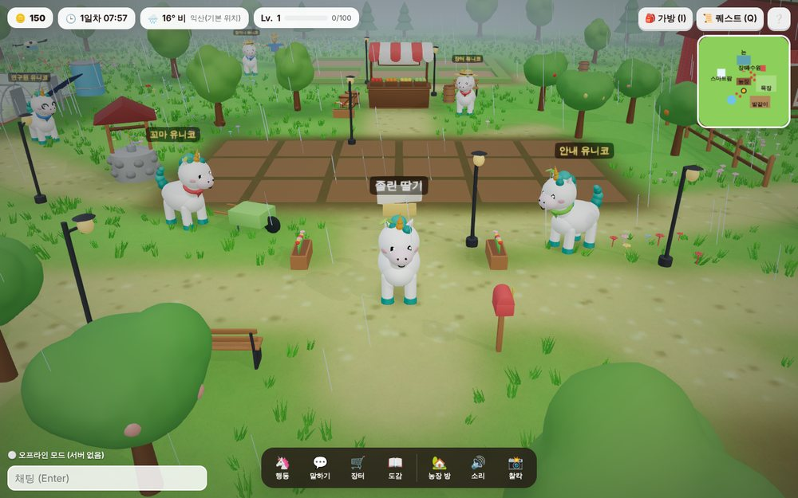 |
| **애니메이션 젖소·말** | **반려견 콩이** | **논 옆 방앗간 풍차** |
| 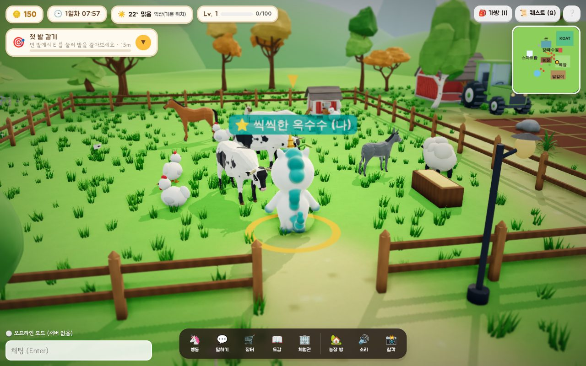 | 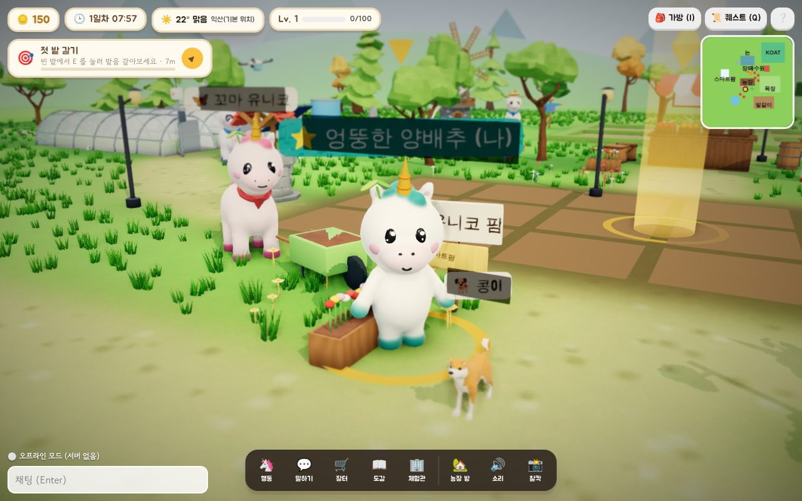 | 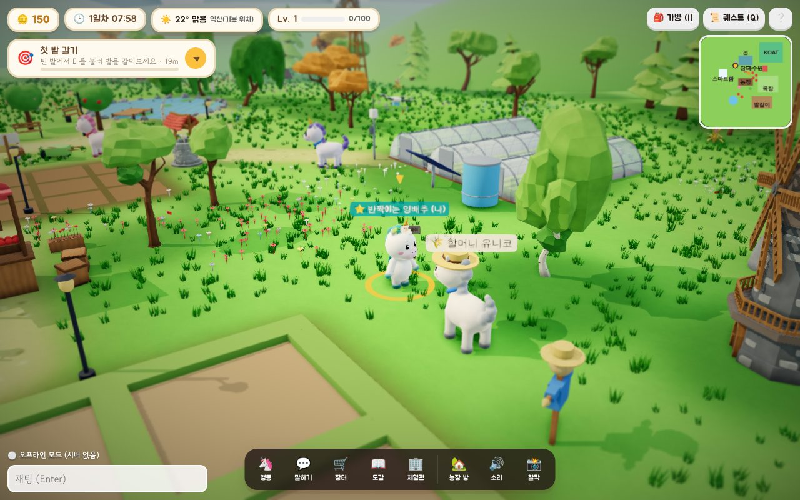 |
| **지도에서 눌러 이동** | **가리면 투명해지는 시야** | **실시간 날씨 (눈)** |
| 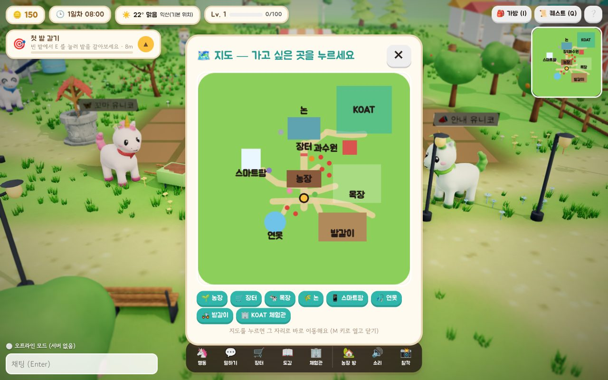 | 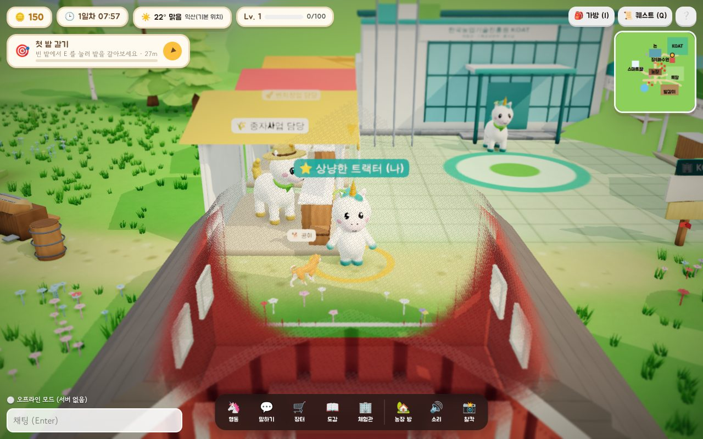 | 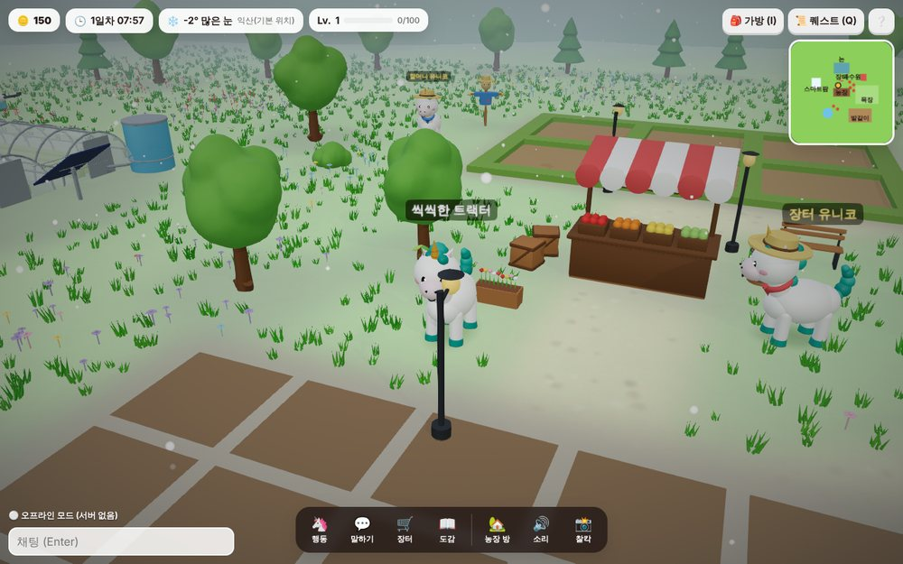 |

## 게임 요소

| 요소 | 내용 |
|---|---|
| 🌱 **경작** | 밭 갈기 → 씨앗 심기 → 물 주기 → 수확. 작물 5종(당근·양배추·토마토·딸기·옥수수), 레벨에 따라 해금. 물을 주면 3배 빨리 자람 |
| 🛒 **경제** | 장터에서 씨앗·사료 구매, 작물·생산물 판매. 시세는 매일 ±18% 랜덤워크(0.55~1.7배), 30% 확률로 "수요 급증(2배)" 이벤트. **7일마다 유니코 수확 축제**: 그날은 모든 작물·생산물이 1.3배(전날 미리 알림, 반짝이는 축제 배너) |
| 🚜 **트랙터 미니게임** | 트랙터에 타서 60초 동안 밭 56칸을 최대한 많이 갈기. W/S 가속·후진, A/D 조향, SPACE 쟁기 올림/내림. 바위에 부딪히면 -3초. 페달이 서서히 밟히고 속도가 오를수록 가속이 줄어 급발진 없이 부드럽게 움직임(운전 중 자기 충돌 판정에 튕기던 문제 수정), 담장에 닿으면 막힌 만큼만 감속 |
| 📱 **스마트팜 미니게임** | 비닐하우스 센서 폴에서 30초 동안 온도·습도·CO₂ 를 목표 범위에 유지(난방/환기/분무/CO₂ 공급). 성공 시 작물 성장 ×1.5~2 부스트 |
| 🐄 **목장** | 젖소·양·닭에게 사료를 주면 일정 시간 후 우유·양털·달걀 생산 → 장터 판매. 젖소·양은 뼈대 애니메이션(젖소 얼룩무늬 셰이더), 닭은 저폴리 암탉(종종걸음·모이 쪼기), 말·당나귀·알파카는 쓰다듬기 가능 |
| 🐕 **반려견 콩이** | 시바견이 졸졸 따라다니고, 멀어지면 뛰어오고, 쉬면 앉아 두리번. 가까이에서 E/탭으로 쓰다듬기, 트랙터를 몰면 뒤따라 달림 |
| 🌾 **논농사** | 논 갈기 → 물 대기 → 모내기 → 단계별 물 높이 관리(모 2~4cm, 분얼기 3~6, 이삭 5~8, 익으면 물떼기 0~1.5) → 잡초 뽑기 → 벼 베기 → 탈곡 연타. 관리 품질이 쌀 등급 ★1~5 를 결정하고, 수확할수록 농사 숙련도가 올라 품질이 더 잘 오름. 비 오는 날은 논에 물이 참 |
| 🎣 **낚시** | 물가에서 찌를 던지고 물고기 그림자가 다가오면, 톡톡 건드리는 가짜 입질은 참고 찌가 쑥 들어갈 때(0.75초) 당기기. 붕어·잉어·메기·우렁이·황금 잉어 등 7종, 밤·비 오는 날 희귀 확률 증가, 크기 기록 |
| 🏞️ **유니코 낚시터 (남서쪽 호수)** | 물 위로 뻗은 부두·나룻배·가게가 있는 호수. 부두 끝이나 물가에서 낚시하면 호수에만 사는 7종(빙어·송어·쏘가리·산천어·가물치·뱀장어·전설의 철갑상어)이 등장. 큰 물고기가 물면 **힘겨루기**: 꾹 눌러 감으면 텐션이 오르고, 빨간 구간이거나 물고기가 몸부림치면 손을 떼야 줄이 안 끊어짐. 낚시꾼 유니코의 가게에서 낚싯대 3단계(대나무·카본·황금)와 떡밥(입질↑·희귀↑) 구매, 기록판의 **오늘의 의뢰**(날마다 바뀌는 목표 물고기·크기)와 최대어 기록. 첫 방문 컷신 |
| 🏊 **수영·잠수** | 호수에 걸어 들어가면 헤엄(개헤엄 동작·물보라·느린 속도), 부두로 올라오거나 물가로 나오면 다시 걷기. 물속 반짝이는 곳에서 잠수하면 민물조개·진주·동전·우렁이 |
| ⛏️ **호미질** | 빈 밭을 갈 때 호미를 들어 두 번 내리찍음(흙 튐·소리). 자라는 밭에 가끔 잡초가 나서 성장이 절반으로 느려지면 호미로 김매기 → 한동안 더 잘 자람 |
| 🌾 **밭농사 심화** | **품질 별(★~★★★)**: 물이 마르지 않게·잡초 없이 돌볼수록 관리 점수가 올라 ★★★ 특상품(수확량 +1), 방치하면 ★(−1). 밭에 다가가면 `관리 ★★☆`가 보임. **퇴비**: 장터에서 사거나 밭 서쪽 퇴비통에 잡초·남는 작물 3개를 넣으면 숙성 → 밭에 주면 30% 빨리 자라고 품질↑(씨앗 심을 때 같이 주기 가능). **대왕 작물**: 다 익을 때 가끔(퇴비 주면 확률 2배) 포기가 크게 자라 수확량 3배. **다시 열리는 작물**: 토마토·딸기는 수확 후 반쯤 자란 상태로 돌아가 2~3번 더 열림. **밭농사 숙련도**(Lv.1~8): 수확·가공·납품으로 오르고 품질 보너스·새 가공품 해금. **스프링클러**(장터, 줄마다): 물이 마르면 자동으로 뿌림 |
| 🏺 **장독대 가공 (6차 산업)** | 밭 서쪽 장독대에서 당근 주스·양배추 김치·토마토 주스·딸기잼·옥수수수염차·딸기 꿀절임을 담금(재료값보다 비싸게 팔림, 숙련도로 해금). 장독은 2개에서 4개까지 늘릴 수 있음 |
| 📋 **오늘의 주문서** | 학교 급식실·마을 식당·로컬푸드 직매장 등에서 날마다 3건 주문(작물·목장 생산물·가공품). 납품하면 시세보다 넉넉한 보상, 3건 모두 하면 보너스 |
| 🐄 **목장 심화** | 동물마다 **이름**(축사 창에서 바꾸기)과 **하트(애정도)**: 하루 한 번 **빗질**(빗을 들고 쓱쓱, 생산 25% 단축)·쓰다듬기, 사료로 오르고 며칠 돌보지 않으면 내려감. ♥가 많을수록 빨리 생산하고 ♥3부터 생산물 2개, ♥4~5는 가끔 **황금 달걀·특급 우유·고급 양털**. 축사 앞 **우리 목장**에서 새끼(송아지·어린 양·병아리)를 들이면 작게 와서 쓰다듬을수록 빨리 자람, **축사 증축**으로 수용 수 확장. **자동 급이 여물통**에 사료를 채우면 배고픈 동물이 알아서 먹음. 밤에는 동물들이 잠듦(💤). **목장 숙련도**와 **목장 가공소**(치즈·털실·카스텔라·딸기 요거트·버터·털목도리) |
| 🙌 **상호작용 동작** | 손에 드는 도구(호미·물뿌리개·곤충채·낚싯대)와 함께: 호미질, 씨앗 심고 토닥이기, 물 주기, 쑥 뽑아 수확, 나무 밀어 흔들기, 곤충채 휘두르기, 사료 뿌리기, 낚싯대 던지기·기다리기·릴 감으며 버티기·잡은 물고기 번쩍 들기, 헤엄·잠수 |
| 🍎 **과수원 / 곤충** | 사과·복숭아·배·감 나무를 하루 한 번 흔들면 열매 3개(가끔 장수풍뎅이나 코인 주머니). 들판의 나비·잠자리·무당벌레, 밤에는 반딧불이 채집 |
| 📖 **도감** | 물고기·곤충·과일 도감, 처음 잡은 것·개수·최대 크기 기록, 카테고리 완성 보상 |
| 💕 **주민** | 장터·연구원·안내·할머니·꼬마 유니코 5명. 하루 첫 인사 +3, 선물(좋아하는 것 +12), 오늘의 부탁(보상 코인), 하트 1~5 단계마다 선물(씨앗·볍씨·코인) |
| 📜 **퀘스트 / 레벨** | 퀘스트 43개(벼농사·낚시·낚시터·수영·잠수·김매기·채집·우정·도감 포함), 보상으로 코인·XP, 레벨업 시 새 작물 해금 |
| 🌅 **낮/밤** | 하루 6분. 태양 각도·하늘색·조명이 바뀌고 아침마다 시세 갱신, 밤에는 가로등 점등·반딧불이 |
| 🌦️ **실시간 날씨** | 브라우저 위치 권한 + Open-Meteo(무료, 키 없음)로 내 위치의 실제 날씨 반영 (거부 시 익산 기본 위치, 15분 갱신). 비·눈·뇌우·안개·흐림·바람이 하늘·조명·잔디·구름에 표현되고, 비가 오면 밭과 논에 자동으로 물, 눈이 오면 작물 성장 40% 감소. 상단 날씨 칩에서 체험용 날씨 전환 |
| 🏗️ **마을 건설** | (공사장 비계·자재는 CC0 KayKit) 서쪽 **새 마을 부지**(지도 🏗️ 새 마을)의 건설 부지 5곳에 코인을 내고 건물을 지음. 공사 중에는 비계가 둘러싸고 건물이 아래부터 차오르며 흙먼지·망치 소리, 코인을 더 내면 바로 완성. 완공되면 농장 전체에 효과: ⛩️ 쉼터 정자(350, 매일 주민 선물) · 💧 물탱크(800, 물 지속 1.5배) · 🏪 농산물 직판장(1,200, Lv.2, 판매가 +10%) · 🌿 유리 온실(1,800, Lv.3, 작물 성장 +15%) · 🌬️ 풍차 방앗간(2,400, Lv.3, 매일 +80코인). 퀘스트 '첫 건물'·'우리 마을' |
| 🤖 **오토플레이** | 행동 막대의 🤖 자동 버튼 또는 **P** 키. 유니코가 알아서 걸어 다니며 수확 → 생산물 거두기 → 물 주기 → 김매기 → 사료 주기 → 씨앗 심기(가진 씨앗 중 이익이 큰 것, 퇴비가 있으면 같이) → 퇴비 → 밭 갈기 → 빗질 → 쓰다듬기 순으로 급한 일을 하되, 가까운 일을 먼저 챙김. 가방이 차거나 씨앗·사료가 떨어지면 장터에서 작물·생산물을 팔고(가공품·특별한 생산물·물고기는 남겨 둠) 필요한 만큼만 삼(30코인은 남겨 둠). 목장은 서쪽 출입구로 드나들고, 밤에는 동물을 깨우지 않음. 직접 움직이면 잠깐 멈췄다가 4초 뒤 이어 가고, 창·대화·미니게임 중에는 쉼. 화면 아래 상태 표시(눌러서 끄기) |
| 🕹️ **조작** | 키보드(WASD/방향키, E, Q, I, P 오토플레이) · 마우스(클릭 이동·상호작용, 드래그 시점, 휠 줌) · 터치(탭 이동·상호작용, 왼쪽 조이스틱, 오른쪽 드래그 시점, 두 손가락 줌) 모두 지원. 트랙터·탈곡·낚시도 화면 버튼/클릭으로 가능 |
| 🌐 **메타버스** | 방(농장)당 최대 50명. 다른 유니코의 위치·포즈·채팅이 실시간 동기화. 방 선택·이동 가능 (내 농장 데이터는 로컬 저장이라 방을 옮겨도 유지) |
| 🦄 **감정표현** | 하단 "행동" 메뉴에서 환호·하트·인사·생각 등 공식 마스코트 포즈를 재생 (다른 플레이어에게도 보임) |
| 🎯 **목표 안내** | 왼쪽 위에 지금 할 일·진행도·거리·방향 화살표, 실제 장소에는 노란 빛기둥. 완료하면 눌러서 바로 보상 |
| 🎵 **사운드** | 외부 파일 없이 합성한 배경음악(오음계 칼림바·패드·베이스, 낮/밤 분위기 전환), 낮 새소리·밤 귀뚜라미·비·바람 환경음, 잔향 있는 부드러운 효과음. 소리 버튼: 모두 켬 → 음악 끔 → 모두 끔 |
| 🗺️ **지도 이동** | 미니맵을 누르거나 M 키로 큰 지도를 열고, 원하는 곳을 누르거나 장소 버튼(농장·장터·목장·논·스마트팜·연못·밭갈이·KOAT)을 누르면 바로 이동. 건물·연못 위를 누르면 가장 가까운 빈자리로 |
| ⚙️ **환경설정 (그래픽 품질)** | 오른쪽 위 ⚙️ → 자동·낮음·보통·높음 프리셋과 세부 항목(해상도 50~100%, 그림자 끔~높음, 풀·들꽃 양, 화면 효과, 주변광 차폐, 미니어처 초점, FPS 표시). 바꾸면 바로 적용되고 브라우저에 저장. '자동'은 기기에 맞춰 시작해 화면이 끊기면(평균 32 FPS 미만) 한 단계씩 낮춤. 저사양 PC 는 '낮음'(해상도 75%·가벼운 그림자·후처리 끔) 권장 |
| ⛰️ **언덕·고지 탐험** | 맵 가장자리 언덕 4곳(해돋이·바람·들꽃·서쪽 전망 언덕)을 걸어 오를 수 있고 캐릭터·동물·풀이 지형 높이를 따름. 꼭대기 전망대에서 경치 감상(천천히 도는 파노라마 연출, 첫 방문 +100🪙), 비탈·숲 가장자리의 숨은 보물 상자 6개(하루에 한 번 코인·씨앗·과일), 지도에 언덕·전망대 표시 |
| 🐦‍⬛ **해로운 동물 쫓아내기** | 까마귀가 밭에 날아와 작물을 쪼면 성장이 밀리고 다 익은 작물이 망가짐, 밤에는 여우·늑대(CC0 애니메이션)가 목장 울타리에 붙어 동물들이 겁먹고 생산이 멈춤. 가까이서 E: 두 팔을 휘저으며 발을 구르는 쫓기 동작 + 반려견이 짖으며 달려들고, 까마귀는 날갯짓하며 날아가고 여우·늑대는 숲으로 달아남 |
| 🐕 **펫 키우기** | 반려견(이름 짓기 가능)의 배부름·애정(하트 5단계). 돌보기 대화에서 쓰다듬기·간식(장터 🦴)·작물 나눠 주기, 하트가 오르면 재주(앉아·빙글빙글·점프·손!·춤추기), 행복하면 가끔 땅을 파서 코인·씨앗·과일을 물어 옴. 배고프면 기운이 없어 천천히 따라옴 |
| 🎮 **미니게임** | 🥚 달걀 받기(닭장, 황금·썩은 달걀·콤보·점점 빨라짐·최고 기록), 🐑 양 몰이(밭 남쪽 들판, 양들이 플레이어와 반려견을 피해 무리 지어 움직임 → 우리에 몰아넣기), 트랙터 밭갈이, 스마트팜 환경제어, 탈곡, 낚시, KOAT 체험 6종 |
| ⭐ **미니게임 공통 연출** | 밭갈이·탈곡·스마트팜·양 몰이·달걀 받기 모두: 시작 전 규칙·조작 카드(별 기준·내 최고 기록) → **3·2·1 카운트다운** → 남은 5초부터 째깍 소리·빨간 깜빡임 → **별 3개 결과 화면**(점수 카운트업, 별이 하나씩 켜짐, 신기록 리본, 꽃가루, 다시 하기). 퀘스트 창에서 미니게임별 최고 기록·별 확인. **밭갈이**: 쉬지 않고 이어 갈면 연속 보너스·진행 막대·별 보너스. **탈곡**: 그냥 연타가 아니라 드럼 속도를 초록 구간에 맞추기, 너무 빨리 밟으면 과열돼 잠깐 멈춤, 낟알이 튐. **스마트팜**: 햇볕·소나기·찬바람·작물 성장 같은 돌발 상황 알림에 맞춰 대응. 체험관 결과에도 별 표시 |
| 🏢 **체험관 미니게임 강화** | 모두 3·2·1 카운트다운 뒤 시작, 결과는 점수 카운트업·별·꽃가루, 처음 통과하면 본부 **스탬프가 쾅** 찍힘. **기술이전 매칭**: 기술과 기업을 곡선으로 이어 주고 45초 제한·빠를수록 보너스. **창업 성장 레이스·트랙터 안전 검정·저탄소 인증**: 한 문제씩 제한 시간 안에 판단(숫자·←→ 키), 맞히면 연속 콤보, 틀리면 바로 이유 설명, 정확도 85점 + 빠르기 15점. 창업 단계를 오르는 로켓, 검정 측정값이 기준선과 함께 움직이는 바늘 게이지, 영농 방법 카드 분류. **종자 정선**: 흘러오는 컨베이어에서 불량 종자만 집어내기(점점 빨라짐, 연속 보너스, 좋은 종자 실수·놓침 감점). **스마트팜 실증**: 돌발 상황 포함 |
| 🐝 **양봉** | 서쪽 들꽃 옆 벌통 3개, 벌들이 날아다니며 낮·맑은 날 꿀이 차면 🍯 꿀 거두기 (장터 판매) |
| 🎬 **대화창 · 컷신** | 주민과 대화하면 카메라가 두 캐릭터를 비추는 구도로 바뀌고, 화면 아래 대화창에 말하는 캐릭터의 3D 초상화·이름표·한 글자씩 나오는 대사와 말소리, 선택지(부탁·선물·장터·퀘스트·이야기 더 하기). 처음 접속하면 안내 유니코가 마을을 소개하는 컷신, KOAT 체험관 첫 방문 컷신 (영화 띠·건너뛰기). E·Space·클릭으로 넘기기, 숫자 키로 선택 |
| 🏃 **자연스러운 움직임** | 주인공은 돌 때 안쪽으로 살짝 기울고 고개가 먼저 돌아가며, 크게 돌아설 땐 조금 천천히 몸을 틂. 출발하면 앞으로 기울었다가 걷기 자세로, 멈출 땐 다음 발 디딤까지 마저 걷고 무게가 실리며 살짝 주저앉았다 돌아옴, 팔 흔들기는 속도만큼. 감정표현·트랙터 타기 시작/끝 자세를 0.3초에 걸쳐 이어 줌, 플레이어 가감속(급출발·급정지 없음), 다른 플레이어는 위치 수신 사이를 일정한 속도로 걸어감, 동물은 몸을 먼저 돌린 뒤 바라보는 쪽으로 걷고 걷기 동작 속도를 실제 이동 속도에 맞춤, 동물끼리·장애물과 겹치지 않음. 보간은 모두 프레임 속도와 무관 |
| 📸 기타 | 미니맵, 찰칵(스크린샷 저장), 모바일 가상 조이스틱, 10초 자동 저장, 둥근 한글 글꼴(Jua·Gowun Dodum)·크림색 패널·튀어나오는 창·코인 숫자 굴러가기·수확물이 가방으로 날아가는 연출 |
 | 🌅 **그래픽 (three.js)** | 해 방향 노을 번짐·해 원반·밤의 별과 달이 있는 하늘 셰이더, 대기 원근감이 있는 3겹 산 능선, `Reflector` 로 나무·하늘이 일렁이며 비치는 연못(잔물결 굴절·프레넬·물가 거품, 저사양은 반사 대신 하늘색 근사), 밤 가로등 빛 웅덩이, 공중에 떠다니는 빛 먼지(해 질 녘 금빛), 노을에 물드는 구름, 캐릭터·반려견·트랙터 발밑에서 옆으로 눕는 잔디 |
| 🎨 그래픽 | 무료 CC0 에셋(Quaternius)으로 헛간·사일로·물탱크·트랙터 창고·풍차 2종·우물·닭장과 나무 5종(일반·소나무·자작·버드·단풍)·덤불·이끼 바위·그루터기·통나무·연잎을 교체·추가하고 게임 팔레트로 재색칠([docs/ASSETS_CC0.md](docs/ASSETS_CC0.md)). 주변광 차폐(GTAO)·틸트시프트 미니어처 초점(고사양), 바람에 흔들리는 나무, 나무·건물이 캐릭터를 가리면 카메라를 당기지 않고 가린 부분만 점묘로 투명해지는 시야 구멍, 거리에 따라 흐려지는 이름표. 재질별 절차적 디테일(나뭇결·기와 줄·칠 바램·돌 얼룩·잎 덩어리·짚 결, 지면 근처 접지 어둠), 색 보정·캐릭터 림 라이트, 흘러가는 구름 그림자, 잔디 뿌리→끝 그라데이션, 수확·채집 반짝임. 한 장으로 칠한 지면(곡선 흙길·부드러운 경계·구운 AO), 하늘 돔·구름·지평선 언덕·원경 산맥, 바람에 흔들리는 잔디 9천 포기·들꽃 군락, 물결 연못과 물가 돌, 가로등·벤치·허수아비 등 소품, 키·필·림 조명, 블룸·SMAA·비네팅, 환경맵, 플레이어 추적 그림자. 그래픽 품질은 환경설정에서 바꾸며 주소에 `?quality=low|medium|high` 로 강제 가능 |

## 🏢 KOAT 체험관 — 한국농업기술진흥원 본부별 기능 체험

| 체험관 광장 (본관 + 본부별 부스 6곳) | 안내데스크 스탬프 투어 |
|---|---|
| 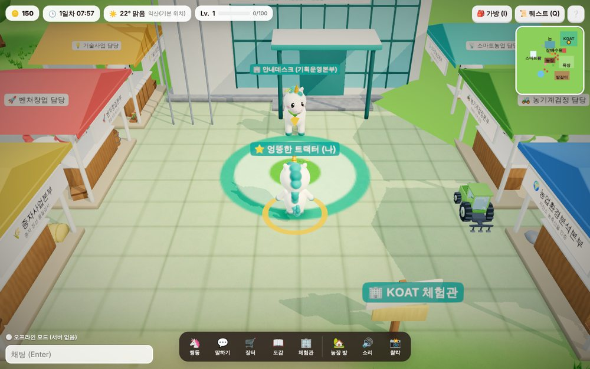 | 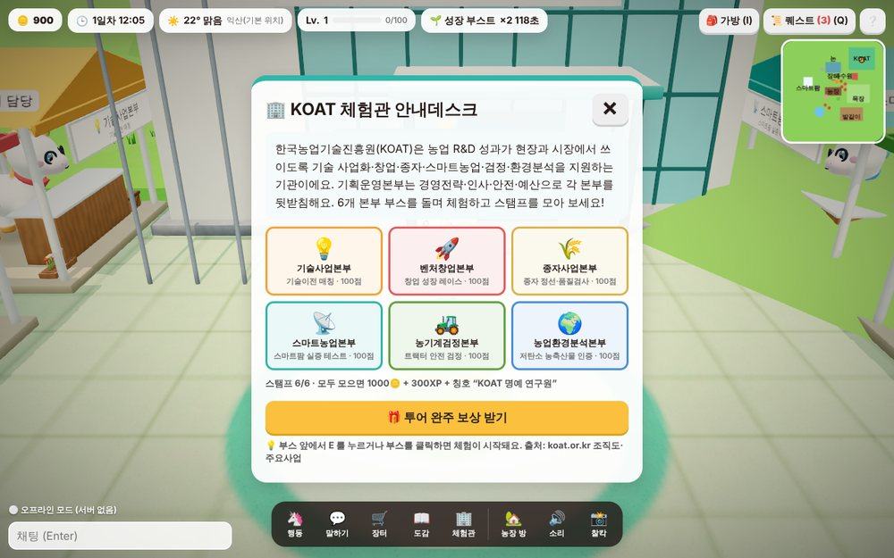 |

북동쪽 광장(하단 🏢 버튼으로 바로 이동)에 KOAT 본관과 6개 사업 본부 부스가 있습니다. 부스마다 본부 색 지붕·간판·담당 유니코가 있고, 본부가 하는 일을 소개한 뒤 그 업무를 미니게임으로 체험합니다. 60점 이상이면 스탬프를 받고, 6개를 모두 모아 본관 앞 안내데스크(기획운영본부)에 가면 1,000🪙 + 300XP + 칭호 "KOAT 명예 연구원"을 받습니다.

| 본부 | 하는 일 (koat.or.kr 기준) | 체험 미니게임 |
|---|---|---|
| 💡 기술사업본부 | 농식품 특허 창출, 기술이전, 사업화 지원, 치유농업, 농기자재 해외 수출 | **기술이전 매칭**: 연구 성과(꿀벌 질병 센서, 쌀가루 제빵 기술 등)를 필요한 기업과 짝지어 계약 체결 |
| 🚀 벤처창업본부 | 농식품 벤처·창업 원스톱 지원(전국 6개 센터), 판로·투자, 그린바이오 생태계 | **창업 성장 레이스**: 예비창업 → 창업 → 성장 → 그린바이오 단계마다 알맞은 지원 고르기 |
| 🌾 종자사업본부 | 신품종 보급, 종자 정선·검사·품질관리, 종자종합처리센터, 종자산업 진흥 | **종자 정선·품질검사**: 15초 안에 깨진·병든 종자와 이물질만 골라내기 |
| 📡 스마트농업본부 | AI·데이터 스마트농업 확산, 인력양성·표준화, 김제·상주 스마트팜 실증단지 | **스마트팜 실증 테스트**: 실증 온실의 온도·습도·CO₂ 를 30초간 적정 범위로 유지 |
| 🚜 농기계검정본부 | 농업기계 검정·시험평가, 자율주행 농기계 성능시험, 농기자재 검·인증 | **트랙터 안전 검정**: 제동거리·전조등·전복보호구조·소음·PTO 덮개·자율주행 오차를 기준과 비교해 적합/부적합 판정 |
| 🌍 농업환경분석본부 | 토양·용수·잔류농약 분석, 농생명 분석, 온실가스 감축사업, 저탄소 농축산물 인증 | **저탄소 농축산물 인증**: 온실가스를 줄이는 영농 방법(중간 물떼기·적정 시비·바이오차 등)만 골라 인증 신청 |

기획운영본부(경영전략·인사·안전·예산)는 본관 안내데스크로 표현했습니다. 본부 구성과 업무 설명은 2026년 11월 1일 기준 [조직도](https://www.koat.or.kr/koat/department.do)·[부서소개](https://www.koat.or.kr/koat/depart_intro.do)·주요사업 페이지를 바탕으로 했습니다. 미니게임 속 기술·기업·측정값은 체험용 예시입니다.

## 🎮 도트(2.5D) 에디션 — `pixel.html`

3D 판과 **같은 게임 규칙**(`src/game/sim/` 의 경작·장터·목장·주민·퀘스트·반려견·낚시)을 쓰고, 그래픽만 **코드로 한 점씩 찍은 도트**로 바꾼 버전입니다. 3D 시작 화면의 "도트(2.5D) 버전으로 하기" 링크나 `/pixel.html` 로 들어갑니다. three.js 를 쓰지 않아 자바스크립트가 약 140KB(압축 전, 3D 판의 약 1/8)입니다.

| 시작 화면 | 밭 | 밤 (가로등·창문 불빛) |
|---|---|---|
| 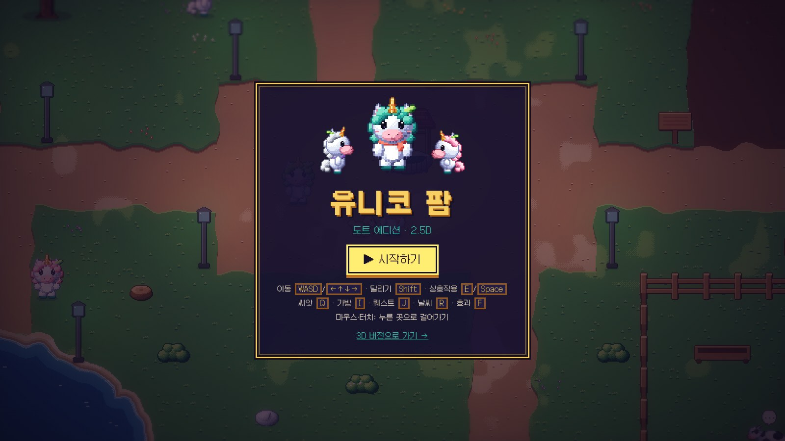 | 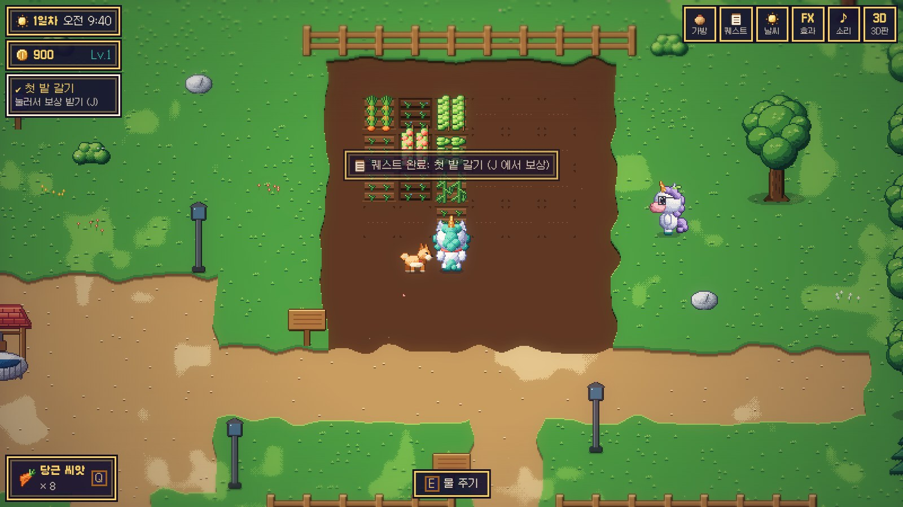 | 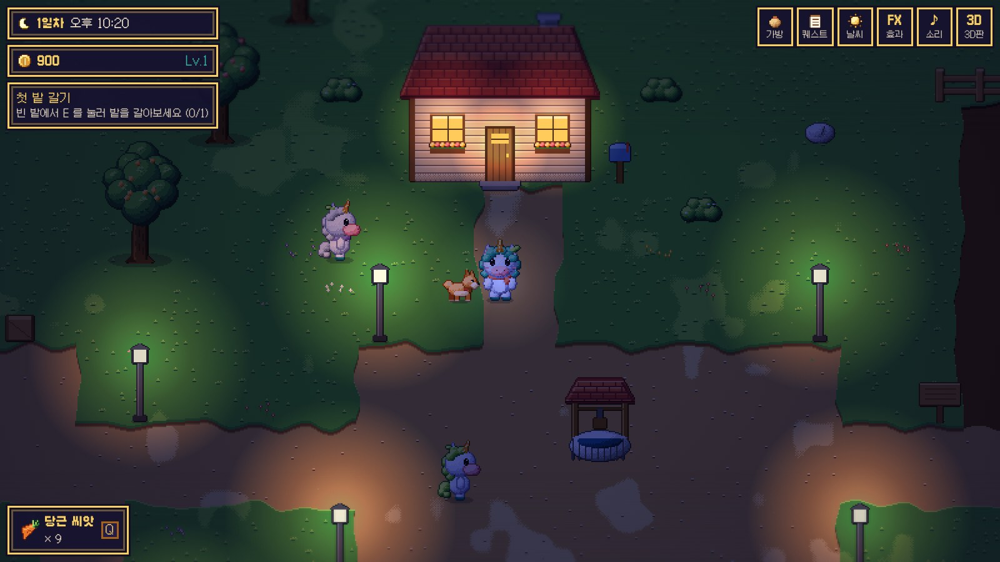 |
| **비 오는 목장** | **연못 낚시** | **주민 대화** |
| 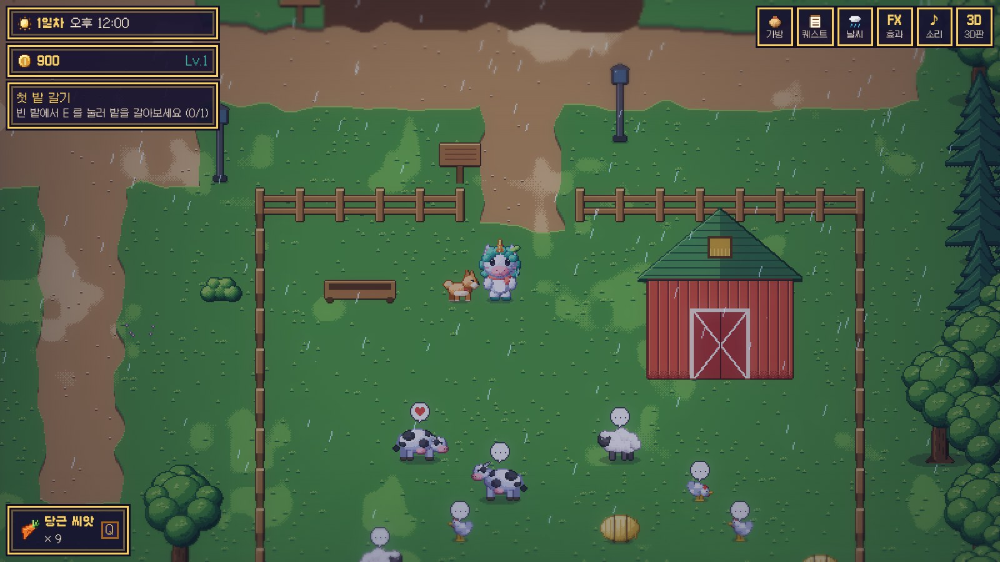 | 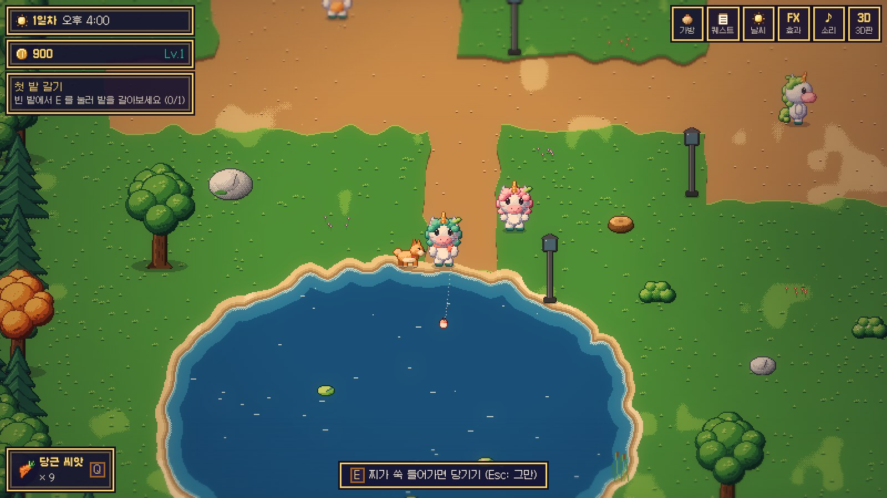 | 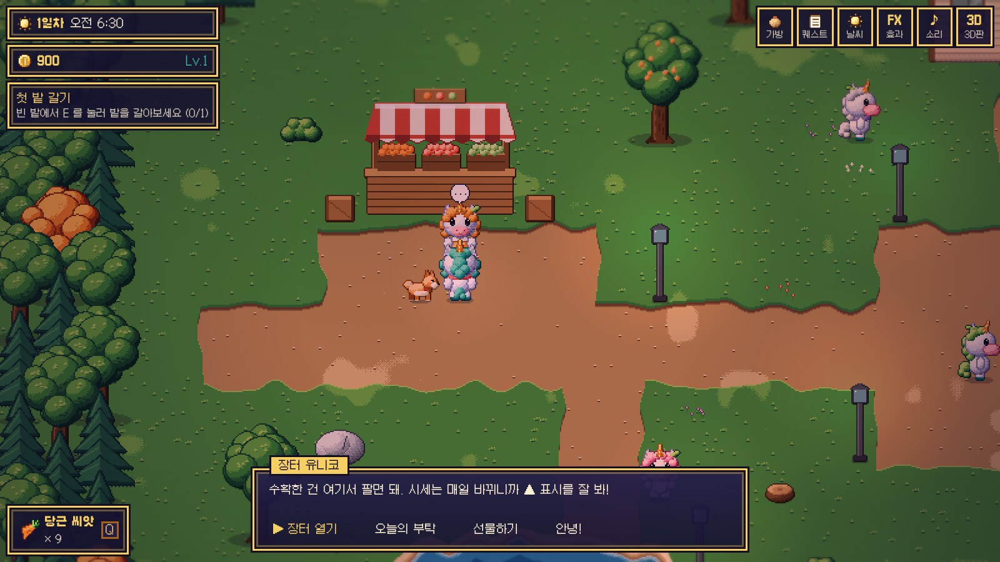 |
| **논농사 (모 → 분얼 → 이삭 → 황금 들녘)** | **트랙터 밭갈이** | |
| 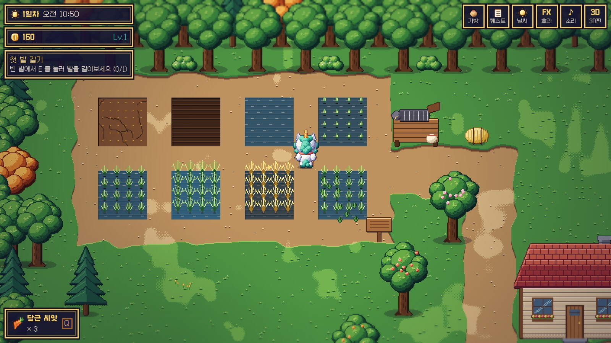 | 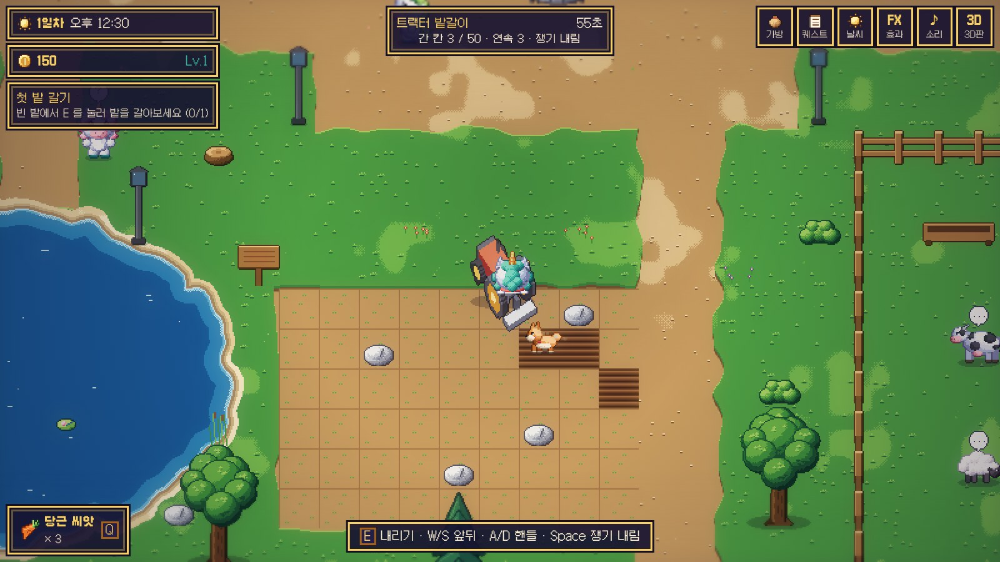 | |

- **촘촘한 도트**: 타일 32px, 캐릭터 40×54px (흔한 16px 타일의 4배 밀도). 화면 배율은 2배부터라 1080p 에서 가로 960점이 보임
- **찍는 방식**: `src/pixel/pxl.js` 의 작은 도트 엔진. GitHub 의 픽셀아트 스킬 [crsolver/claude-pxl](https://github.com/crsolver/claude-pxl)(MIT)의 작업 습관을 따름: 재질별 2~5단 명암 램프, 대칭은 반만 그리고 거울, 외곽선은 자동(이웃 재질의 가장 어두운 색 = 셀아웃), 부위 경계 1px 선, 의미 없는 점 노이즈 금지(판자 줄·기와 줄·잎 덩어리·이랑처럼 이유 있는 무늬만), 빛나는 재질은 밤 조명과 블룸에 반영
- **캐릭터**: 두 발 이등신 유니코 4방향 × 걷기 4프레임(흰 몸·청록 곱슬 갈기·주황 띠 금색 뿔·분홍 주둥이·새싹 머리핀), 주민 5명(장터·안내·할머니·꼬마·연구원, 갈기 색·앞치마·안경·숄로 구분), 시바견 콩이(따라다니는 동료), 젖소·양·닭(걷기·풀 뜯기·새끼)
- **지형**: 지도 전체(1792×1280점)를 픽셀마다 구움. 구불구불한 경계, 풀 가장자리 그림자, 물가 모래·젖은 모래, 물 깊이 3단, 일렁이는 물가 거품·반짝이는 물결, 무리 지어 난 풀잎·길 위 자갈
- **HD-2D 풍 효과** (`F` 로 켜고 끔): 위·아래 틸트시프트 흐림, 빛 번짐(블룸), 비네팅, 시간대 색(새벽 분홍·한낮·노을 주황·밤 남색), 밤 가로등·창문 불빛(곱하기 + 더하기 조명), 흘러가는 구름 그림자, 바람에 흔들리는 나무, 빛 먼지·떨어지는 잎·반딧불이·비. 느린 기기에서는 평균 40fps 아래면 블룸 → 흐림 순서로 자동으로 끔
- **조작**: 8방향 이동(`Shift` 달리기), `E`/`Space` 상호작용, `Q` 씨앗 바꾸기, `I` 가방, `J` 퀘스트, `R` 날씨, `M` 소리. 마우스·터치는 누른 곳까지 길 찾기로 걸어가고, 사람·밭·동물을 누르면 가서 바로 상호작용. 휴대폰에서는 십자 패드 + A/B 버튼
- **들어 있는 것**: 밭 24칸(갈기·심기·물·김매기·수확·별 품질·대왕 작물·다시 열리는 작물), 장터(씨앗·사료·간식·퇴비 사기, 시세 ▲▼ 보며 팔기·전부 팔기), 목장(사료·빗질·쓰다듬기·생산물·여물통·밤에 잠듦), 주민(인사·이야기·오늘의 부탁·선물·하트 보상), 반려견(쓰다듬기·간식·재주·땅 파서 보물), 연못 낚시(가짜 입질 참고 쑥 들어갈 때 당기기), 과일나무 흔들기, 집에서 자고 다음 날, 하루 6분·날씨·축제, 퀘스트·레벨·씨앗 해금, 10초 자동 저장(3D 판과 저장은 따로)
- **글꼴**: 한글 픽셀 글꼴 [갈무리(Galmuri)](https://github.com/quiple/galmuri) (SIL OFL 1.1)
- **논농사** (북서쪽 논 8마지기, 3D 판과 같은 `RiceSim`): 논 갈기 → 물 대기 → 모내기(볍씨) → 단계마다 물 높이 맞추기(모 2~4cm · 분얼기 3~6 · 이삭 5~8 · 익으면 물떼기 0~1.5) → 잡초 뽑기 → 벼 베기. 논에 들어가면 물을 헤치며 천천히 걷고 물이 튐. 비 오면 논물이 참. 벼 4단계(모·분얼기·이삭·황금 들녘)와 물 높이에 따라 비치는 논물이 보임. **탈곡기**에서 6초 동안 연타해 드럼 속도를 초록 구간에 맞추면 쌀 ★1~5
- **트랙터 밭갈이** (남쪽 밭 9×6칸, 3D 판과 같은 `Vehicle`·`FieldSim`): 차고의 트랙터를 타면 3·2·1 뒤 60초. 방향키를 누른 쪽(화면 기준)으로 트랙터가 알아서 핸들을 꺾어 향하고(페달은 서서히 밟힘, 크게 돌 땐 속도를 줄임, 벽에 막히면 잠깐 후진하며 돎), Space 쟁기, E 내리기. 연속으로 갈면 보너스, 바위에 부딪히면 -3초, 별 3개 기준·최고 기록. 트랙터는 **스프라이트 스태킹**(복셀 단면을 1px씩 쌓는 2.5D 기법)으로 32방향을 미리 구워 어느 쪽으로 돌아도 도트가 유지됨
- **부드러운 이동**: 칸 단위가 아니라 픽셀 단위 8방향, 가속·감속(약 0.15초), 벽 따라 미끄러지기·모서리 자동 비켜 가기, 걸음은 실제 이동 거리에 맞춤, 반려견은 지나온 길을 그대로 따라옴, 카메라는 가는 쪽을 살짝 앞서 보며 소수점 단위로 스크롤
- 아직 없는 것: 멀티플레이, 스마트팜·KOAT 체험관·마을 건설 (3D 판에서)

코드 구조와 도트 추가 방법은 `.claude/skills/unico-pixel-art/SKILL.md`. 도트 시트 미리보기는 개발 서버에서 `/pixel-sheet.html?s=4`.

## 캐릭터

**주인공 유니코(와 다른 접속자)는 두 발로 서서 두 손을 쓰는 이등신 캐릭터**(큰 머리 ≈ 몸통+다리 높이, 어깨에서 손까지 매끈하게 가늘어지는 짧은 팔)이고, 마을 주민 NPC는 네 발 유니콘입니다. 몸·목·머리·주둥이·귀·다리·발굽·갈기·꼬리를 부호 거리 함수(SDF)로 정의해 스무스 유니온으로 녹인 **이음새 없는 한 덩어리 메시**이고, 부위별 뼈(두 발: 몸통·머리·다리 2·팔 2·꼬리 / 네 발: 몸통·머리·다리 4·꼬리)에 부드러운 스킨 가중치를 줘서 관절이 자연스럽게 휘어집니다 (`src/game/unico_mesh.js`, 미리 구운 `public/models/unico_biped.bin` 610KB · `unico_body.bin` 439KB, `node scripts/build-unico-mesh.mjs` 로 재생성). 원안 마스코트에서 흰 몸, 청록 곱슬 갈기·꼬리·발굽, 주황 띠가 있는 금색 뿔, 분홍 주둥이와 볼, 큰 검은 눈, 새싹 머리핀을 가져왔습니다. 블렌더 없이 게임 코드로 만들며, 모든 접속자가 같은 지오메트리를 공유하고 캐릭터 하나가 몸통 1회 + 얼굴 부품 몇 회의 그리기로 끝나 50명이 모여도 가볍습니다.

- 애니메이션: 걷기(두 발은 다리 교차 + 팔 반대로 흔들기, 네 발은 대각선 교차. 실제 이동 거리로 보폭을 맞춰 발이 미끄러지지 않고 디딘 발은 땅에 붙음), 숨쉬기, 눈 깜빡임, 꼬리 흔들기, 두리번거리기, 트랙터 의자에 앉아 두 손으로 핸들 잡기
- 접지감: 부드러운 몸통 그림자 + 발굽 4개 접지 그림자, 걸음마다 흙먼지
- 감정표현(두 발): 만세 점프(한 바퀴), 손 흔들기, 두 손 모아 하트, 턱 괴고 생각, 손으로 가리키며 발표·외치기, 두 손 내밀어 물주기·태블릿 + 머리 위 아이콘
- 옷차림: 밀짚모자, 안전모(트랙터), 고글, 스카프(빨강·초록·파랑)
- 구분: 내 캐릭터는 원안 색(흰 몸·청록 갈기) + 발밑 금색 링 + 머리 위 화살표 + 청록 이름표 "⭐ 이름 (나)". 주민 NPC는 역할별 몸·갈기 색(장터 주황, 연구원 보라, 안내 초록, 할머니 은색, 꼬마 분홍)과 역할 아이콘이 붙은 크림색 이름표. 다른 접속자는 파란 이름표 "👤 이름"

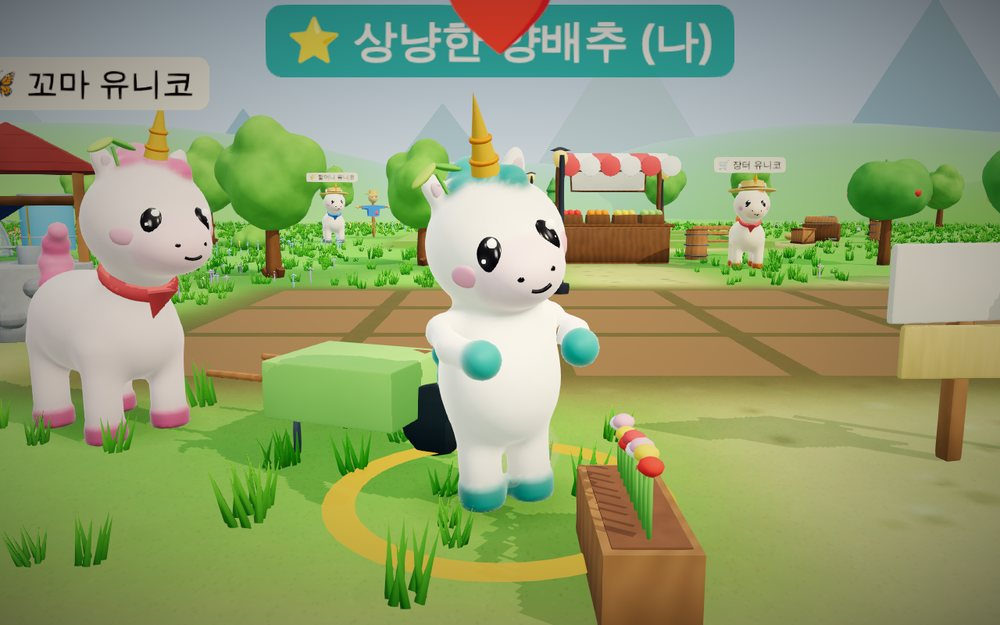

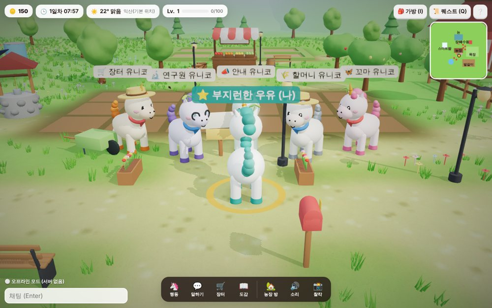

예전에 시도한 블렌더 조형 캐릭터와 원본 일러스트 2.5D 스프라이트는 품질 문제로 폐기했습니다.

환경 에셋(나무·헛간·사일로·풍차·비닐하우스·센서·태양광·드론·트랙터·젖소·양·닭·작물 5종×3단계 등 24종)은 Blender 파이썬 스크립트로 프로시저럴 생성해 glTF 로 내보냈습니다. `.blend` 파일은 `blender/blend/` 에 있어 Blender 에서 바로 열어 수정할 수 있습니다.

## 실행

```bash
npm install
npm run dev            # http://localhost:5173  (클라이언트)
npm run server         # ws://localhost:8787    (멀티플레이 서버, 선택)
```

개발 서버는 `/ws` 를 8787 포트로 프록시합니다. 서버가 없어도 오프라인(싱글)으로 플레이됩니다.

배포용:

```bash
npm run build          # dist/
npm start              # Node 서버가 dist 정적 파일 + WebSocket 을 함께 서빙
```

### 에셋 다시 만들기 (Blender)

```bash
pip install bpy                                       # Blender 5.x 파이썬 모듈
python3 blender/build_all.py                          # 환경 에셋 24종 → public/models/*.glb, blender/blend/*.blend
```

Blender 실행파일로도 가능합니다: `blender -b -P blender/build_all.py -- tractor cow`

Blender 로 다시 만든 뒤에는 `npm run models:compress` 로 압축합니다(1.4MB → 0.6MB). 외부 CC0 에셋(`public/models/q_*.glb`)은 원본 FBX/glTF 를 받아 `blender/import_cc0.py`(묶기) → `scripts/optimize-cc0.mjs`(재색칠·meshopt 압축) 순서로 만듭니다. 절차는 [docs/ASSETS_CC0.md](docs/ASSETS_CC0.md).

### 테스트 / 밸런스 점검

```bash
npm test               # 게임 규칙(경작·경제·퀘스트·트랙터·스마트팜·목장·논·낚시·도감·주민·날씨) + 서버 로직, 21개
```

```bash
node scripts/balance.mjs   # 자원 유입·분당 수익·지배 전략·차익 루프 점검 (docs/BALANCE.md)
```

## 동시 접속 규모

| 구성 | 동시 접속(대략) | 비고 |
|---|---|---|
| Node 서버 1대 (`server/index.js`) | 방당 50명, 서버당 수백 명 | `MAX_PLAYERS_PER_ROOM`, `MAX_ROOMS` 환경변수로 조절. 위치는 5Hz 전송·10Hz 묶음 브로드캐스트 |
| Cloudflare Workers + Durable Objects 무료 플랜 (`deploy/cloudflare/`) | 방당 50명, 하루 약 100 플레이어·시간 | 일일 요청 한도(약 10만 요청, WebSocket 메시지 20개=1요청) 기준 추정. 유료 $5/월이면 약 100배 |
| Vercel 무료 | 클라이언트만 | 서버리스는 WebSocket 상시 연결 불가 → 클라이언트는 Vercel, 서버는 Cloudflare/Fly.io/Render 등에 분리 |

**렌더링 수치** (1280×800, 스폰 화면, 그림자 패스 포함): 고사양 드로우콜 약 1,000 · 삼각형 약 180만 · 그림자맵 3072, 저사양(모바일 자동) 드로우콜 약 480 · 삼각형 약 75만 · 그림자맵 1024·3프레임마다 갱신. 게임 로직(JS)은 프레임당 약 0.8ms. 움직이지 않는 장식은 모델이 달라도 질감 종류가 같으면 정점 색으로 한 번에 그리고, 트랙터·닭·드론·체험관 부스 같은 움직이는 모델도 부품을 합치며, 애니메이션 동물은 1마리당 한 번에 그립니다.

**브라우저 성능 최적화**
- 캐릭터 LOD: 카메라에서 16m 넘게 떨어진 유니코는 삼각형이 약 1/3인 저해상도 메시로 그림(같은 뼈대 공유라 동작은 그대로), 24m 밖은 그림자 생략, 40m 밖은 얼굴 소품 생략. 화면 밖 캐릭터는 그리지 않음(프러스텀 컬링)
- 그림자: 높이 0.7m 미만 소품·농작물은 그림자를 그리지 않음 (그림자 패스 드로우콜 약 1/3 감소)
- 연못 반사: 2프레임에 한 번만 갱신하고, 반사 화면에서는 풀·꽃·반딧불 같은 작은 것을 뺌
- 지면 메시 분할 1/4, HUD는 값이 바뀔 때만 DOM 갱신(매 프레임 innerHTML 제거), 프레임당 메모리 할당 거의 없음(GC 끊김 방지)
- 시작 시 셰이더를 미리 컴파일한 뒤 화면을 열어, 처음 둘러볼 때 멈칫거림이 없음
- 로딩: three.js 를 별도 청크로 분리(게임 코드만 바뀐 업데이트는 three 캐시 재사용), Node 서버는 JS·모델을 brotli/gzip 으로 압축 전송(전체 6.8MB → 약 2.9MB)하고 ETag 로 재방문 시 304 응답, 해시가 붙은 빌드 파일은 영구 캐시
- 설정의 그래픽 품질(자동/저/중/고)과 FPS 자동 조절은 그대로 동작
- **글자·버튼 크기**(환경설정): 보통 · 크게(1.15배) · 아주 크게(1.3배). 위쪽 막대가 두 줄이 되면 미니맵·목표·알림이 자동으로 그 아래로 내려가고, 좁은 화면에서는 채팅이 행동 막대 위로 올라감

수천 명 규모가 필요하면 Colyseus 같은 룸 서버나 서버 수평 확장(방을 서버별로 분산)이 필요합니다. 자세한 배포 절차는 [docs/DEPLOY.md](docs/DEPLOY.md) 참고.

## 프로젝트 구조

```
blender/                 Blender(bpy) 에셋 생성 스크립트 + .blend
  common.py              프리미티브/머티리얼/결합/glTF 내보내기 헬퍼
  build_environment.py   농장/목장/스마트팜/농기계/동물/작물 에셋
  build_all.py           전체 빌드
  import_cc0.py          외부 CC0 FBX → GLB 묶음
scripts/optimize-cc0.mjs CC0 GLB 재색칠·애니메이션 정리·meshopt 압축 (glTF-Transform)
public/models/           GLB (자체 제작 + CC0 q_*.glb)
src/
  main.js                게임 루프 / 부트스트랩
  game/world.js          월드 배치(LAYOUT), 조명, 충돌, 낮/밤
  game/unico.js          유니코 3D 캐릭터 (코드 조립, 애니메이션, 감정표현, 옷차림)
  game/sim/*.js          렌더링과 분리된 게임 규칙 (테스트 대상)
  game/view/*.js         밭/목장/트랙터/스마트팜/NPC 3D 뷰
  game/net.js            멀티플레이 클라이언트
  ui/                    HUD·패널·미니맵·스타일
server/                  Node WebSocket 릴레이 (rooms.js 는 전송 계층 독립)
deploy/cloudflare/       Durable Objects 버전 릴레이 + wrangler.toml
tests/                   node:test 단위 테스트
docs/                    게임 디자인, 배포, 스크린샷
.claude/skills/          이 저장소 작업용 에이전트 스킬
```

## 참고한 서비스 / 오픈소스

- [잠깐오리(waitduck.com)](https://waitduck.com) — "연못 방 50명 단위 선택, 자동 닉네임, 하단 액션바, 미니맵" 같은 가벼운 메타버스 UX를 참고(답습이 아닌 농장 맥락으로 재해석).
- [Quaternius](https://quaternius.com) — 농장 건물·자연물·애니메이션 동물 CC0 모델 (퍼블릭 도메인, [docs/ASSETS_CC0.md](docs/ASSETS_CC0.md)).
- three.js, Vite, ws, Blender bpy, glTF-Transform, meshoptimizer, Open-Meteo. 게임 제작에 활용한 에이전트 스킬 목록은 [docs/SKILLS.md](docs/SKILLS.md).

## 라이선스 / 캐릭터 저작권

유니코 캐릭터의 저작권은 한국농업기술진흥원에 있습니다. 코드는 저장소 소유자의 정책에 따릅니다.
`public/models/q_*.glb` 는 Quaternius 의 CC0 1.0 에셋을 변환한 것으로 제한 없이 사용할 수 있습니다(`public/models/LICENSE-CC0.txt`).
