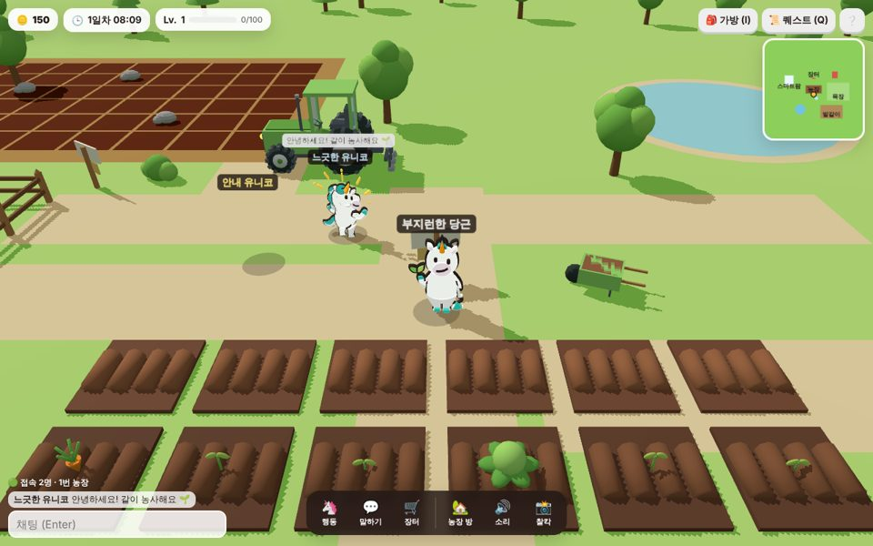
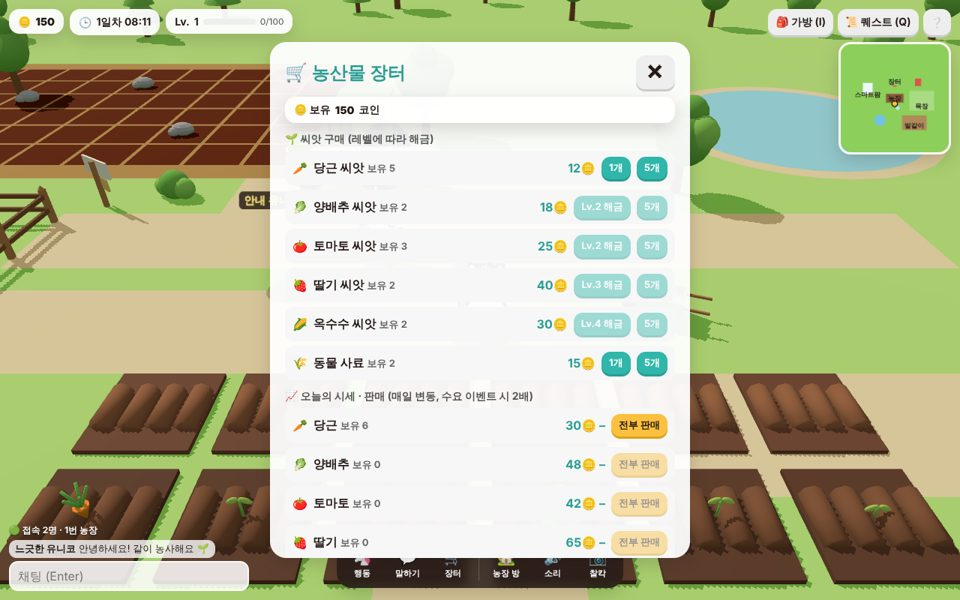
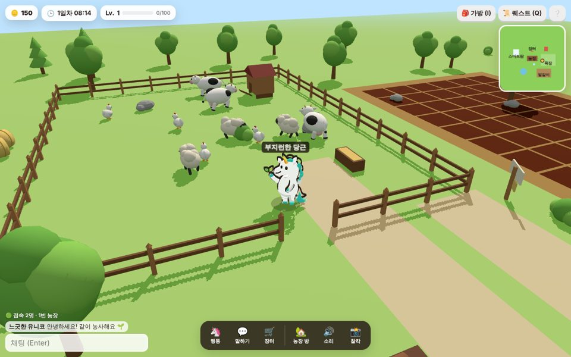
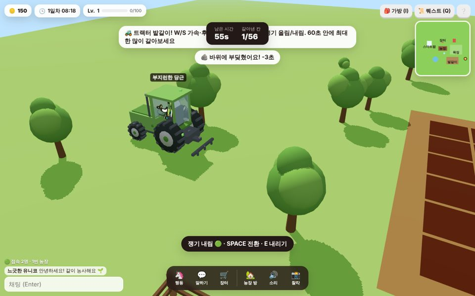
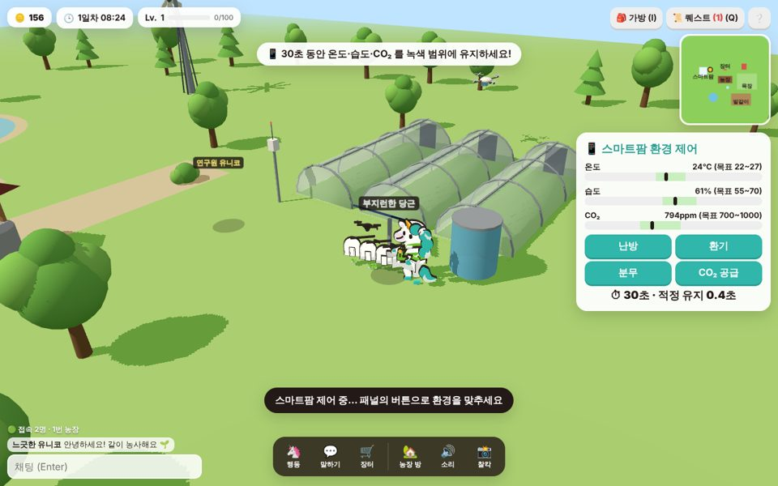

# 🦄 유니코 팜 (UNICO Farm) — 농업 메타버스

한국농업기술진흥원 마스코트 **유니코(UNICO)** 와 함께하는 캐주얼 3D 농장 메타버스 게임입니다.
브라우저에서 바로 실행되며, 같은 서버에 접속한 사람들이 한 농장에서 서로를 보고 채팅할 수 있습니다.

| 농장 | 장터 | 목장 |
|---|---|---|
|  |  |  |
| **트랙터 밭갈이** | **스마트팜 환경제어** | **밤 / 멀티플레이** |
|  |  |  |

## 게임 요소

| 요소 | 내용 |
|---|---|
| 🌱 **경작** | 밭 갈기 → 씨앗 심기 → 물 주기 → 수확. 작물 5종(당근·양배추·토마토·딸기·옥수수), 레벨에 따라 해금. 물을 주면 3배 빨리 자람 |
| 🛒 **경제** | 장터에서 씨앗·사료 구매, 작물·생산물 판매. 시세는 매일 ±18% 랜덤워크(0.55~1.7배), 30% 확률로 "수요 급증(2배)" 이벤트 |
| 🚜 **트랙터 미니게임** | 트랙터에 타서 60초 동안 밭 60칸을 최대한 많이 갈기. W/S 가속·후진, A/D 조향, SPACE 쟁기 올림/내림. 바위에 부딪히면 -3초 |
| 📱 **스마트팜 미니게임** | 비닐하우스 센서 폴에서 30초 동안 온도·습도·CO₂ 를 목표 범위에 유지(난방/환기/분무/CO₂ 공급). 성공 시 작물 성장 ×1.5~2 부스트 |
| 🐄 **목장** | 젖소·양·닭에게 사료를 주면 일정 시간 후 우유·양털·달걀 생산 → 장터 판매 |
| 📜 **퀘스트 / 레벨** | 튜토리얼 퀘스트 11개, 보상으로 코인·XP, 레벨업 시 새 작물 해금 |
| 🌅 **낮/밤** | 하루 6분. 태양 각도·하늘색·조명이 바뀌고 아침마다 시세 갱신 |
| 🌐 **메타버스** | 방(농장)당 최대 50명. 다른 유니코의 위치·포즈·채팅이 실시간 동기화. 방 선택·이동 가능 (내 농장 데이터는 로컬 저장이라 방을 옮겨도 유지) |
| 🦄 **감정표현** | 하단 "행동" 메뉴에서 환호·하트·인사·생각 등 공식 마스코트 포즈를 재생 (다른 플레이어에게도 보임) |
| 📸 기타 | 미니맵, 찰칵(스크린샷 저장), 효과음(WebAudio 합성), 모바일 가상 조이스틱, 10초 자동 저장 |
| 🎨 그래픽 | 하늘 돔·구름·지평선 언덕, 바람에 흔들리는 잔디 인스턴싱, 물결 연못, 프로시저럴 지면 텍스처, 블룸·SMAA·비네팅 후처리, 환경맵, 플레이어 추적 고해상도 그림자. 모바일은 자동으로 저사양 프리셋(`?quality=low/high`) |

## 캐릭터

현재 게임 캐릭터는 첨부된 디자인 가이드(AI 파일)의 유니코 벡터를 PyMuPDF 로 고해상도 투명 PNG 로 래스터한 **2.5D 스프라이트**입니다. 원본과 색·비율이 동일하고, 카메라를 향하는 평면에 그려 이동 방향에 따라 정면·3/4·뒷면 그림을 전환합니다. 물주기·안전모·환호·하트 등 14개 포즈를 감정표현과 액션에 씁니다 (`public/sprites/`).

블렌더로 만든 입체 캐릭터(프리미티브 조합, 벡터 릴리프, 리메시 조형)는 원본과 인상이 달라 모두 폐기했습니다. 입체 캐릭터는 이미지→3D 생성 모델(Hunyuan3D, Tripo, Meshy 등)로 다시 만드는 것을 검토 중입니다.

환경 에셋(나무·헛간·사일로·풍차·비닐하우스·센서·태양광·드론·트랙터·젖소·양·닭·작물 5종×3단계 등 24종)은 Blender 파이썬 스크립트로 프로시저럴 생성해 glTF 로 내보냈습니다. `.blend` 파일은 `blender/blend/` 에 있어 Blender 에서 바로 열어 수정할 수 있습니다.

## 실행

```bash
npm install
npm run dev            # http://localhost:5173  (클라이언트)
npm run server         # ws://localhost:8787    (멀티플레이 서버, 선택)
```

개발 서버는 `/ws` 를 8787 포트로 프록시합니다. 서버가 없어도 오프라인(싱글)으로 플레이됩니다.

배포용:

```bash
npm run build          # dist/
npm start              # Node 서버가 dist 정적 파일 + WebSocket 을 함께 서빙
```

### 에셋 다시 만들기 (Blender)

```bash
pip install bpy pymupdf                               # Blender 5.x 파이썬 모듈
python3 blender/build_all.py                          # 환경 에셋 24종 → public/models/*.glb, blender/blend/*.blend
python3 blender/render_character_sprites.py <유니코.ai>  # 캐릭터 포즈 → public/sprites/unico_*.png
```

Blender 실행파일로도 가능합니다: `blender -b -P blender/build_all.py -- tractor cow`

### 테스트

```bash
npm test               # 게임 규칙(경작·경제·퀘스트·트랙터·스마트팜·목장) + 서버 방/채팅 로직 단위 테스트
```

## 동시 접속 규모

| 구성 | 동시 접속(대략) | 비고 |
|---|---|---|
| Node 서버 1대 (`server/index.js`) | 방당 50명, 서버당 수백 명 | `MAX_PLAYERS_PER_ROOM`, `MAX_ROOMS` 환경변수로 조절. 위치는 5Hz 전송·10Hz 묶음 브로드캐스트 |
| Cloudflare Workers + Durable Objects 무료 플랜 (`deploy/cloudflare/`) | 방당 50명, 하루 약 100 플레이어·시간 | 일일 요청 한도(약 10만 요청, WebSocket 메시지 20개=1요청) 기준 추정. 유료 $5/월이면 약 100배 |
| Vercel 무료 | 클라이언트만 | 서버리스는 WebSocket 상시 연결 불가 → 클라이언트는 Vercel, 서버는 Cloudflare/Fly.io/Render 등에 분리 |

수천 명 규모가 필요하면 Colyseus 같은 룸 서버나 서버 수평 확장(방을 서버별로 분산)이 필요합니다. 자세한 배포 절차는 [docs/DEPLOY.md](docs/DEPLOY.md) 참고.

## 프로젝트 구조

```
blender/                 Blender(bpy) 에셋 생성 스크립트 + .blend
  common.py              프리미티브/머티리얼/결합/glTF 내보내기 헬퍼
  vector_extract.py      AI(PDF) 파일에서 마스코트 벡터 추출 (PyMuPDF)
  build_character_relief.py  원본 벡터 → 릴리프 3D 캐릭터 (기본 캐릭터)
  build_environment.py   농장/목장/스마트팜/농기계/동물/작물 에셋
  build_all.py           전체 빌드
public/models/           생성된 GLB (약 3.5MB)
src/
  main.js                게임 루프 / 부트스트랩
  game/world.js          월드 배치(LAYOUT), 조명, 충돌, 낮/밤
  game/unico.js          유니코 엔티티 (빌보드, 방향별 포즈, 감정표현)
  game/sim/*.js          렌더링과 분리된 게임 규칙 (테스트 대상)
  game/view/*.js         밭/목장/트랙터/스마트팜/NPC 3D 뷰
  game/net.js            멀티플레이 클라이언트
  ui/                    HUD·패널·미니맵·스타일
server/                  Node WebSocket 릴레이 (rooms.js 는 전송 계층 독립)
deploy/cloudflare/       Durable Objects 버전 릴레이 + wrangler.toml
tests/                   node:test 단위 테스트
docs/                    게임 디자인, 배포, 스크린샷
.claude/skills/          이 저장소 작업용 에이전트 스킬
```

## 참고한 서비스 / 오픈소스

- [잠깐오리(waitduck.com)](https://waitduck.com) — "연못 방 50명 단위 선택, 자동 닉네임, 하단 액션바, 미니맵" 같은 가벼운 메타버스 UX를 참고(답습이 아닌 농장 맥락으로 재해석).
- three.js, Vite, ws, Blender bpy, PyMuPDF. 게임 제작에 활용한 에이전트 스킬 목록은 [docs/SKILLS.md](docs/SKILLS.md).

## 라이선스 / 캐릭터 저작권

유니코 캐릭터의 저작권은 한국농업기술진흥원에 있습니다. 코드는 저장소 소유자의 정책에 따릅니다.
